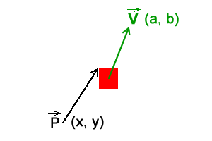
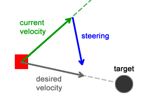
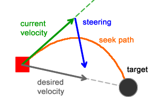

<!--
## GOSH THAT WAS INSANELY FUN TO READ

This is my first note of a (hopefully not) loong serie of notes...

Notes which convey anything i feel like writing at the moment.
So keep in mind, this won't always cover concepts i learned or heck,
be related to this project.

## Back into it
-->

## Preface, Context?, idk

The first thing i needed to figure out in this stupid project is movements.

Or to more precise, how to make movements nicer for the player and life-like,

The thing is, at the time i'm writtin this, The player movement is too snappy.
Or too robotic in a way.

Basically, movement in any direction will often time, make the player turn 
**instantly!**, Which i fucking hate because in the original game, what
struck me the most is that every rockets turns were fucking curved! 
not straight arrows that stare into your souls!

The worst was that i had no idea how to fix that :/

So i did like any good Computer science larper of my time do...

_I asked claude for help._

But don't be afraid, i didn't asked him the solution (yet),
i knew internet is full of magnificient post made by people smarter than me.

So i asked him to help me to find a way to get to those blogs with the background
That i want to figure out the math by myself.
(Because surpringsinly, LLM's are bad at explaining Vector Maths, either that or i'm a dumbass)

And oh boy, i was dumbfounded, when he told me i should just lookup **Steering bahaviors**

I felt so dumb, _why did i never thought about that phrasing?_

After looking that up, i stumbled onto [the blog that solved my issue](https://code.tutsplus.com/understanding-steering-behaviors-seek--gamedev-849t)

**This is getting interesting, i swear :)**

## Steering behavior: Seek

### The basic solution

Disclaimer, this part needs a basic understanding of math vectors.

OK, so basically.
The problem is, you want to seek a target, and you want the seeking to be _smooth_

The solution for the first part is to simply find in which way (direction) to go.
Then multiply that direction by some speed to represent the vector.

Reminder, Vectors got two properties:
    a direction: which tell you where to go
    a magnitude (or length): which tell you how fast it moves every frame



The math is as follows:

```pseudo
direction = normalize(target - position)
velocity = direction * speed # might be max_velocity, max_speed, etc

# In most cases people write the lines above in one like this:
# velocity = normalize(target - position) * speed

# Since, i'm on godot, i don't need to directly touch the position, i can just use move_and_slide()
# But that's something to keep in mind if you want to tweak your movement
position = position + velocity
```

### The issue and the solution

The issue with this is that, yes, it seeks. 
But if the direction change, it will snap instantly. Which not the _smoothness_
we're aiming for.

Turns out, the solution is to use two forces:
- desired_velocity: this is basically what we did above, where we want to go.
- steering: the substraction of `desired_velocity` by the `current_velocity`

The concept is simple

It snaps instantly, because we're directly setting the `current_velocity` 
to the `desired_velocity`

But to make turns more curvy, we need to represent the change between those two vectors,
And apply it incremently.

This looks like this




```pseudo
desired_velocity = normalize(target - position) * speed
steering = desired_velocity - velocity
```

but hold on, we still need to add the steering force in order for this to work
We normalize a bunch of stuffs first before

```pseudo
steering = truncate(steering, max_steering_force)
steering = steering / mass # not always necesserary

velocity = truncate(velocity + steering, max_speed)

# Again, not necessary if you use Godot CharacterBody2D:move_and_slide()
position = position + velocity
```


